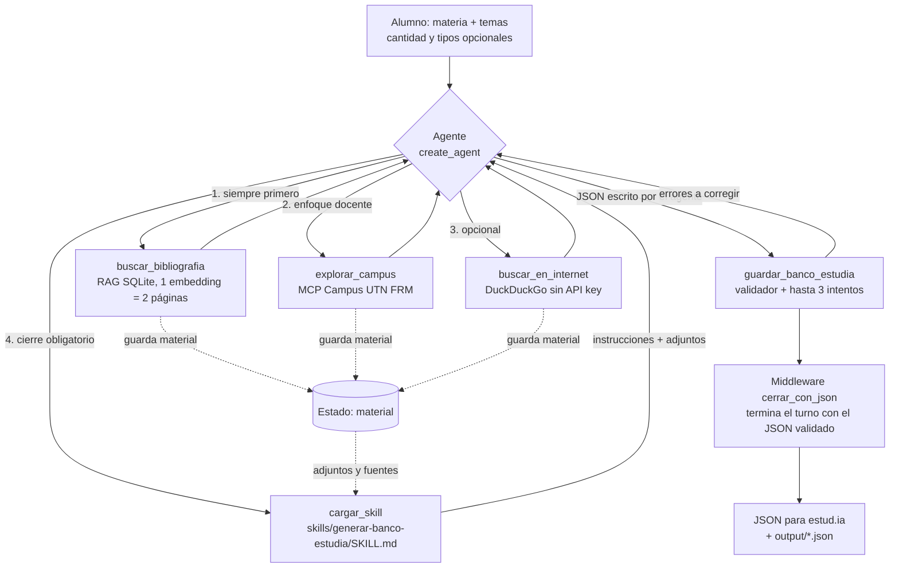

# 🎓 Generador de práctica para estud.ia (UTN FRM)

Agente de IA construido con `create_agent` de LangChain para alumnos de la UTN FRM. El alumno le dice **materia** y **temas** (y, si quiere, la cantidad y los tipos de pregunta). El agente consulta la **bibliografía oficial de la cátedra** (RAG), el **Campus Virtual UTN FRM** (MCP) y, solo si hace falta, **internet**. Con ese material genera un **banco de preguntas en JSON**, validado y listo para cargar en [estud.ia](https://estud-ia-blond.vercel.app/).

Trabajo Integrador de Modelos de Lenguaje (Unidad 5, 2026).

## Caso de uso

| | |
|---|---|
| **Dominio** | Práctica para exámenes con el material oficial de la cátedra |
| **Usuario objetivo** | Alumno de la UTN FRM que prepara un parcial y quiere practicar con preguntas fieles a lo que piden los docentes |
| **Tarea de ejemplo** | *"Haceme 10 preguntas de Modelos de Lenguaje sobre embeddings y transformers"*: el agente busca en el libro, cruza con las filminas del campus, completa si hace falta con la web y entrega el JSON |
| **Resultado tangible** | Un archivo `.json` con el formato de estud.ia, guardado en `output/` y descargable desde la UI |

## Flujo del agente



La generación del banco es una **skill**: un `SKILL.md` con las instrucciones del formato de estud.ia que el agente carga bajo demanda con `cargar_skill` (el system prompt solo lista su nombre y descripción, así no ocupa contexto hasta que hace falta). Con esas instrucciones el propio agente escribe el JSON a partir del material que ya tiene en la conversación, y lo entrega a `guardar_banco_estudia`, que lo valida, devuelve los errores para que el agente los corrija (hasta 3 intentos por pedido) y lo guarda. Los archivos que sube el alumno no aparecen como resultado de ninguna tool, así que viajan junto con la skill. Además, `guardar_banco_estudia` se niega a guardar si antes no se consultó `buscar_bibliografia`, así que el orden libro → campus → web también se hace cumplir en código, no solo en el prompt.

## Requisitos

- Python 3.10 o superior y Git
- `GROQ_API_KEY` ([Groq](https://console.groq.com/keys)): el modelo del agente (tier gratuito)
- `GOOGLE_API_KEY` ([AI Studio](https://aistudio.google.com/apikey)): embeddings del RAG (`gemini-embedding-001`, tier gratuito)
- Usuario y contraseña del Campus Virtual UTN FRM (opcional: sin ellos, el agente sigue sin el campus)

## Instalación

**1. Clonar y entrar**

`--recursive` también descarga el servidor MCP del campus, que es un submódulo:

```bash
git clone --recursive https://github.com/Tomiaranda/ProyectoModelosDeLenguaje.git
cd ProyectoModelosDeLenguaje
```

**2. Entorno virtual y dependencias**

```bash
python -m venv .venv
.venv\Scripts\Activate.ps1        # Windows (macOS/Linux: source .venv/bin/activate)
pip install -r requirements.txt
```

**3. Servidor MCP del campus**: es el submódulo `campus-utn-frm-mcp/` ([ignaw05/campus-utn-frm-mcp](https://github.com/ignaw05/campus-utn-frm-mcp)). Usa el mismo entorno virtual, porque sus dependencias (`mcp`, `httpx`) ya están en `requirements.txt`. Si clonaste sin `--recursive`:

```bash
git submodule update --init
```

**4. Configurar el `.env`**

```bash
cp .env.example .env              # Windows: Copy-Item .env.example .env
```

Completá `GROQ_API_KEY`, `GOOGLE_API_KEY`, `CAMPUS_USER` y `CAMPUS_PASS`. Para cambiar de modelo o proveedor:

| Proveedor | Configuración |
|---|---|
| OpenRouter (por defecto) | `MODEL_PROVIDER=openrouter`, `MODEL_NAME=nvidia/nemotron-3.5-super-vl:free` (respaldo opcional en `MODEL_FALLBACKS`) |
| Groq | `MODEL_PROVIDER=groq`, `MODEL_NAME=openai/gpt-oss-120b` |
| Google AI Studio | `MODEL_PROVIDER=google_genai`, `MODEL_NAME=gemma-4-26b-a4b-it` (o un Gemini, p. ej. `gemini-2.5-flash`) |
| LM Studio | `MODEL_PROVIDER=lmstudio`, `MODEL_NAME=<id del modelo cargado>` |

**5. Indexar la bibliografía** (el repo ya trae el índice `rag/bibliografia.db`; solo hace falta regenerarlo cuando agregás o cambiás libros)

Cada subcarpeta de `rag/libros/` es una materia y cada PDF de esa carpeta es un libro:

```
rag/libros/
└── modelos-de-lenguaje/
    ├── BancoU1ML.pdf
    ├── BancoU2ML.pdf
    └── Resumen Modelos de Lenguaje - Unidades 1 y 2.pdf
```

```bash
python -m rag.ingest                       # todas las materias
python -m rag.ingest modelos-de-lenguaje   # solo una
```

**6. Ejecutar**

```bash
streamlit run app.py              # interfaz web
python agente.py                  # o por consola
```

**7. Pruebas** (sin red ni claves)

```bash
python -m pytest tests
```

## Deploy en Streamlit Community Cloud

1. En [share.streamlit.io](https://share.streamlit.io), elegí **Create app** → repositorio `Tomiaranda/ProyectoModelosDeLenguaje`, rama `main`, archivo `app.py`.
2. En **Advanced settings**, elegí Python **3.12** y pegá los secretos en formato TOML. Streamlit los expone como variables de entorno, así que el código los lee igual que desde el `.env`:

   ```toml
   MODEL_PROVIDER = "groq"
   MODEL_NAME = "openai/gpt-oss-120b"
   GROQ_API_KEY = "..."
   GOOGLE_API_KEY = "..."
   # Opcional, ver la advertencia de abajo:
   # CAMPUS_USER = "..."
   # CAMPUS_PASS = "..."
   ```

3. Deploy. El índice del RAG y el MCP del campus (submódulo) vienen en el repo, así que no hace falta ningún paso extra.

> ⚠️ Una app de Community Cloud es **pública** por defecto: cualquiera que la use gasta tus claves y, si cargaste `CAMPUS_USER`/`CAMPUS_PASS`, entra al campus **con tu cuenta**. Restringí quién puede verla (**Settings → Sharing**: solo los emails que invites) o no cargues las credenciales del campus. Sin ellas, el agente sigue con libros y web.

La memoria (`memoria.db`) y los JSON de `output/` se guardan en el disco del contenedor, que se borra cuando la app se reinicia o se duerme.

## Demo sugerida

1. *"Haceme 8 preguntas de Modelos de Lenguaje sobre tokenización y embeddings."* Se ven en orden las tools de búsqueda, la carga de la skill y la validación, y al final el JSON, con un botón para descargarlo.
2. *"Agregale 4 de verdadero o falso y hacelo más difícil."* Este turno depende de la **memoria**: reutiliza el material del turno anterior sin volver a buscar.
3. Cargá el JSON descargado en [estud.ia](https://estud-ia-blond.vercel.app/).

## Estructura

```
├── app.py               # UI de Streamlit (streaming de tools y resultado)
├── agente.py            # System prompt, create_agent, middleware de cierre, conversaciones
├── tools.py             # Estado del agente, tools de búsqueda, cargar_skill y guardar_banco_estudia
├── skills/
│   ├── __init__.py      # Descubre las skills (skills/<nombre>/SKILL.md) y arma el catálogo
│   └── generar-banco-estudia/SKILL.md   # Instrucciones y formato oficial de estud.ia
├── llm/adaptadores.py   # Patrón Adapter: Groq, OpenRouter, Gemini, LM Studio + embeddings
├── rag/
│   ├── store.py         # Base vectorial en SQLite (similitud coseno con numpy)
│   ├── ingest.py        # PDF -> fragmentos de 2 páginas -> embeddings -> SQLite
│   └── libros/<materia>/*.pdf
├── campus/
│   ├── cliente_mcp.py   # Cliente MCP (stdio) del servidor campus_mcp.py
│   └── archivos.py      # Texto de PDF / PPTX / DOCX descargados del campus
├── estudia/
│   ├── formato.py       # Tipos de pregunta de estud.ia
│   └── validador.py     # Validación estructural del JSON
└── tests/               # Pruebas del validador y de las skills
```

Se generan al usar la app y no se versionan: `memoria.db`, `conversaciones.txt`, `output/` y `descargas_campus/`. El índice `rag/bibliografia.db` sí se versiona (pesa unos 400 KB), para que el deploy funcione sin correr la ingesta.

## Justificación de componentes

| Componente | Por qué está |
|---|---|
| **`create_agent`** | Lo exige la consigna. La tarea tiene varios pasos (libro → campus → web → generar) y el modelo decide qué consultas hacer según los temas pedidos. |
| **Modelo: GPT-OSS 120B (Groq)** | Modelo de *reasoning* con *tool calling* nativo, buen castellano y **expone su razonamiento**. Groq lo sirve rápido y tiene tier gratuito. En la barra lateral se puede cambiar por los otros modelos de reasoning de Groq (GPT-OSS 20B, Qwen 3.8 27B, MiniMax M2.7, Muse Spark Open). Antes se usaba Gemma 4 31B por OpenRouter, pero sus modelos `:free` daban 429 muy seguido y el respaldo (ERNIE) muchas veces no razonaba. |
| **Patrón Adapter (`llm/adaptadores.py`)** | `agente.py` y `tools.py` solo conocen `AdaptadorLLM` (`modelo_chat()` y `completar()`). Cambiar de proveedor es cambiar el `.env` o registrar un adaptador nuevo, sin tocar el agente ni las tools. Lo mismo vale para los embeddings. |
| **`buscar_bibliografia` (RAG, tool propia)** | Es la fuente principal: las definiciones salen del libro de la cátedra. SQLite evita depender de un motor vectorial externo. Un embedding cubre 2 páginas para que cada fragmento tenga una definición o demostración completa con su contexto, y se puede citar como "libro, págs. X-Y". Cada fragmento se recorta a 2.200 caracteres y se devuelven 3 por consulta, para cuidar el contexto. |
| **`explorar_campus` (MCP, externa)** | Cruza la teoría con el recorte de temas y los ejercicios de los docentes. Usa el servidor MCP del campus por stdio y extrae el texto de las filminas y guías que descarga. Las 3 acciones de navegación van en una sola tool para que el modelo tenga menos herramientas entre las que elegir. |
| **`buscar_en_internet` (externa)** | Completa con conceptos actuales o ejemplos solo cuando hace falta. Usa DuckDuckGo (`ddgs`), que es gratis y no pide API key. |
| **Skill `generar-banco-estudia` (propia)** | `skills/generar-banco-estudia/SKILL.md` tiene el formato oficial de estud.ia y las reglas para escribir el banco. El agente la carga con `cargar_skill` solo al cerrar el pedido (divulgación progresiva) y escribe el JSON él mismo, sin una segunda llamada a otro LLM. Agregar otra skill es sumar una carpeta con su `SKILL.md`. |
| **`guardar_banco_estudia` (tool propia)** | **Valida** el JSON que escribió el agente siguiendo la skill (tipos, índices, huecos `___`, cantidad, explicaciones, repetidas). Si hay errores, se los devuelve para que los corrija, hasta 3 intentos por pedido. Guarda el archivo en `output/`. |
| **Memoria (`SqliteSaver`)** | Permite iterar sobre el banco ("agregá 5 más", "solo verdadero/falso"). El material de los turnos anteriores queda en la conversación y en el estado, y la skill lo reutiliza. |
| **Middleware `cerrar_con_json` (propio)** | Cuando `guardar_banco_estudia` valida el banco, termina el turno con ese JSON tal cual. Así se garantiza que la salida final sea *exclusivamente* el JSON validado, sin que el modelo lo reescriba, y se ahorra una llamada al LLM. No se usa ningún middleware prearmado de LangChain. |
| **Middleware `exigir_cierre` (propio)** | Si el modelo termina el turno sin entregar el banco después de haber consultado la bibliografía, le recuerda **una vez** el paso 4 (cargar la skill y guardar el banco) y vuelve a llamarlo. Lo motivó un caso real: un modelo gratuito entró en un bucle de razonamiento y cerró el turno sin JSON. Un solo recordatorio por turno evita los bucles. La UI muestra cuándo actúa. |
| **Temperatura 0.6 y tope de salida** | Los modelos de razonamiento se repiten en bucle con temperatura 0. Con 0.6 (lo que recomiendan los proveedores) y un tope de salida, un bucle se corta a tiempo. La temperatura se configura con `LLM_TEMPERATURE`; el tope sale del esfuerzo de razonamiento (`LLM_EFFORT`: bajo/medio/alto = 8k/12k/16k tokens de salida; en Groq va como `reasoning_effort` low/medium/high y en OpenRouter y Gemini como presupuesto de 100/200/500 tokens para pensar). Se configura en el `.env` (por defecto, bajo). |
| **Reintentos ante 429** | Los resuelve el propio cliente de LangChain (`max_retries=6`, con espera exponencial), así que no hace falta middleware. |
| **UI Streamlit** | Muestra en vivo cada tool con sus argumentos y un resumen del resultado, renderiza markdown y presenta el JSON final con un botón de descarga. |

### Razonamiento del modelo

El adaptador de Groq le pide el razonamiento al modelo (`reasoning_effort` según el nivel bajo/medio/alto, y `reasoning_format: parsed` en los modelos que no son GPT-OSS). `ChatOpenAI` descarta el campo `reasoning` de la respuesta, así que una subclase lo conserva en `additional_kwargs`. La UI lo muestra en un bloque "💭 Razonamiento del modelo", separado del contenido final. Si el modelo elegido no devuelve razonamiento, ese bloque simplemente no aparece y la UI sigue mostrando el recorrido completo de tools con sus argumentos y resultados.

## Limitaciones conocidas y mejoras

- El tier gratuito de Groq limita peticiones y tokens por minuto (429 si se pasa). Una demo completa usa de 6 a 10 llamadas; los reintentos con espera exponencial cubren los picos. Si un modelo se da de baja, se cambia `MODEL_NAME` por otro de reasoning con tool calling.
- `pypdf` no extrae texto de PDFs escaneados: esos libros necesitarían OCR antes de indexarlos.
- La similitud se calcula en memoria con numpy. Alcanza para unos pocos libros por materia, pero con bibliotecas grandes convendría `sqlite-vec`.
- El MCP del campus depende del HTML de Moodle. Si el campus cambia, puede romperse; en ese caso la tool devuelve el error y el agente sigue sin el campus.
- El validador comprueba la estructura, no si el contenido es correcto. La calidad de las preguntas depende del material recuperado.
- Mejoras posibles: OCR, re-ranking de fragmentos y caché del contenido del campus por materia.

## Seguridad

- `.env` no se versiona; `.env.example` no tiene claves reales.
- Las credenciales del campus solo se pasan al subproceso del MCP, que es de solo lectura y solo accede a `campusvirtual.frm.utn.edu.ar`.
