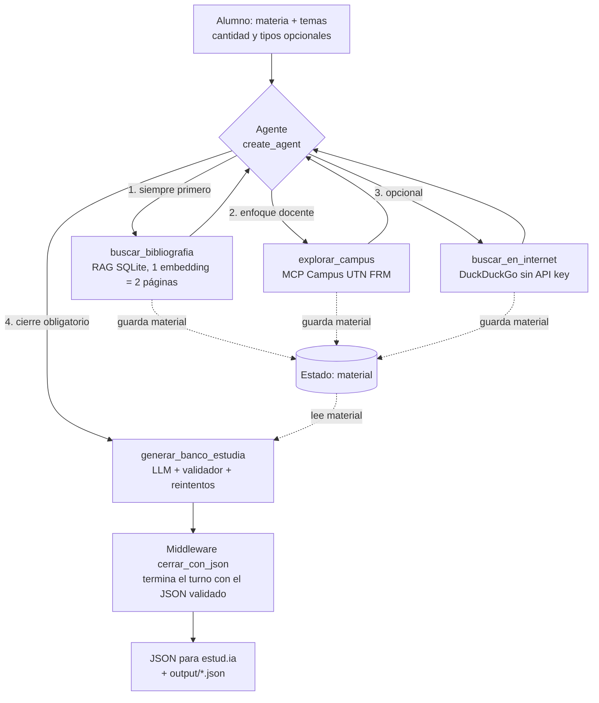

# 🎓 Generador de práctica para estud.ia (UTN FRM)

Agente de IA construido con `create_agent` de LangChain para alumnos de la UTN FRM. El alumno le dice **materia** y **temas** (y, si quiere, la cantidad y los tipos de pregunta). El agente consulta la **bibliografía oficial de la cátedra** (RAG), el **Campus Virtual UTN FRM** (MCP) y, solo si hace falta, **internet**. Con ese material genera un **banco de preguntas en JSON**, validado y listo para cargar en [estud.ia](https://estud-ia-blond.vercel.app/).

Trabajo Integrador de Modelos de Lenguaje (Unidad 5, 2026).

## Caso de uso

| | |
|---|---|
| **Dominio** | Práctica para exámenes con el material oficial de la cátedra |
| **Usuario objetivo** | Alumno de la UTN FRM que prepara un parcial y quiere practicar con preguntas fieles a lo que piden los docentes |
| **Tarea de ejemplo** | *"Haceme 10 preguntas de Modelos de Lenguaje sobre embeddings y transformers"*: el agente busca en el libro, cruza con las filminas del campus, completa si hace falta con la web y entrega el JSON |
| **Resultado tangible** | Un archivo `.json` con el formato de estud.ia, guardado en `output/` y descargable desde la UI |

## Flujo del agente



Las tres tools de búsqueda guardan lo que encuentran en el estado del agente (`material`). La generadora lo lee de ahí, así el modelo no tiene que copiar todo el material en los argumentos de la llamada. Además, la generadora se niega a trabajar si antes no se consultó `buscar_bibliografia`, así que el orden libro → campus → web también se hace cumplir en código, no solo en el prompt.

## Requisitos

- Python 3.10 o superior y Git
- `OPENROUTER_API_KEY` ([OpenRouter](https://openrouter.ai/keys)): el modelo del agente, gratis con los modelos `:free`
- `GOOGLE_API_KEY` ([AI Studio](https://aistudio.google.com/apikey)): embeddings del RAG (`gemini-embedding-001`, tier gratuito)
- Usuario y contraseña del Campus Virtual UTN FRM (opcional: sin ellos, el agente sigue sin el campus)

## Instalación

**1. Clonar y entrar**

```bash
git clone https://github.com/<usuario>/ProyectoFinalModelosDeLenguaje.git
cd ProyectoFinalModelosDeLenguaje
```

**2. Entorno virtual y dependencias**

```bash
python -m venv .venv
.venv\Scripts\Activate.ps1        # Windows (macOS/Linux: source .venv/bin/activate)
pip install -r requirements.txt
```

**3. Servidor MCP del campus**: se clona dentro de la carpeta del proyecto. Usa el mismo entorno virtual, porque sus dependencias (`mcp`, `httpx`) ya están en `requirements.txt`.

```bash
git clone https://github.com/ignaw05/campus-utn-frm-mcp.git
```

**4. Configurar el `.env`**

```bash
cp .env.example .env              # Windows: Copy-Item .env.example .env
```

Completá `OPENROUTER_API_KEY`, `GOOGLE_API_KEY`, `CAMPUS_USER` y `CAMPUS_PASS`. Para cambiar de modelo o proveedor:

| Proveedor | Configuración |
|---|---|
| OpenRouter (por defecto) | `MODEL_PROVIDER=openrouter`, `MODEL_NAME=google/gemma-4-31b-it:free` |
| Gemini | `MODEL_PROVIDER=google_genai`, `MODEL_NAME=gemini-2.5-flash` |
| LM Studio | `MODEL_PROVIDER=lmstudio`, `MODEL_NAME=<id del modelo cargado>` |

**5. Indexar la bibliografía** (una vez, y cada vez que agregues libros)

Cada subcarpeta de `rag/libros/` es una materia y cada PDF de esa carpeta es un libro:

```
rag/libros/
└── modelos-de-lenguaje/
    ├── BancoU1ML.pdf
    ├── BancoU2ML.pdf
    └── Resumen Modelos de Lenguaje - Unidades 1 y 2.pdf
```

```bash
python -m rag.ingest                       # todas las materias
python -m rag.ingest modelos-de-lenguaje   # solo una
```

**6. Ejecutar**

```bash
streamlit run app.py              # interfaz web
python agente.py                  # o por consola
```

**7. Pruebas** (sin red ni claves)

```bash
python -m pytest tests
```

## Demo sugerida

1. *"Haceme 8 preguntas de Modelos de Lenguaje sobre tokenización y embeddings."* Se ven en orden las 4 tools y al final el JSON, con un botón para descargarlo.
2. *"Agregale 4 de verdadero o falso y hacelo más difícil."* Este turno depende de la **memoria**: reutiliza el material del turno anterior sin volver a buscar.
3. Cargá el JSON descargado en [estud.ia](https://estud-ia-blond.vercel.app/).

## Estructura

```
├── app.py               # UI de Streamlit (streaming de tools y resultado)
├── agente.py            # System prompt, create_agent, middleware de cierre, conversaciones
├── tools.py             # Estado del agente y las 4 tools
├── llm/adaptadores.py   # Patrón Adapter: OpenRouter, Gemini, LM Studio + embeddings
├── rag/
│   ├── store.py         # Base vectorial en SQLite (similitud coseno con numpy)
│   ├── ingest.py        # PDF -> fragmentos de 2 páginas -> embeddings -> SQLite
│   └── libros/<materia>/*.pdf
├── campus/
│   ├── cliente_mcp.py   # Cliente MCP (stdio) del servidor campus_mcp.py
│   └── archivos.py      # Texto de PDF / PPTX / DOCX descargados del campus
├── estudia/
│   ├── formato.py       # Prompt oficial del formato estud.ia
│   └── validador.py     # Validación estructural del JSON
└── tests/               # Pruebas del validador
```

Se generan al usar la app y no se versionan: `memoria.db`, `conversaciones.txt`, `rag/bibliografia.db`, `output/` y `descargas_campus/`.

## Justificación de componentes

| Componente | Por qué está |
|---|---|
| **`create_agent`** | Lo exige la consigna. La tarea tiene varios pasos (libro → campus → web → generar) y el modelo decide qué consultas hacer según los temas pedidos. |
| **Modelo: Gemma 4 31B (OpenRouter, gratis)** | Tiene *tool calling* nativo, 256k de contexto, buen castellano y **expone su razonamiento**. Es gratis. La idea original era Llama 3.3 70B, pero OpenRouter dio de baja su versión `:free` y hoy no hay ningún Llama gratis con tool calling. Como respaldo, OpenRouter prueba `nvidia/nemotron-3-ultra-550b-a55b:free` en el mismo request si Gemma da 429 (`MODEL_FALLBACKS`). |
| **Patrón Adapter (`llm/adaptadores.py`)** | `agente.py` y `tools.py` solo conocen `AdaptadorLLM` (`modelo_chat()` y `completar()`). Cambiar de proveedor es cambiar el `.env` o registrar un adaptador nuevo, sin tocar el agente ni las tools. Lo mismo vale para los embeddings. |
| **`buscar_bibliografia` (RAG, tool propia)** | Es la fuente principal: las definiciones salen del libro de la cátedra. SQLite evita depender de un motor vectorial externo. Un embedding cubre 2 páginas para que cada fragmento tenga una definición o demostración completa con su contexto, y se puede citar como "libro, págs. X-Y". Cada fragmento se recorta a 2.200 caracteres y se devuelven 3 por consulta, para cuidar el contexto. |
| **`explorar_campus` (MCP, externa)** | Cruza la teoría con el recorte de temas y los ejercicios de los docentes. Usa el servidor MCP del campus por stdio y extrae el texto de las filminas y guías que descarga. Las 3 acciones de navegación van en una sola tool para que el modelo tenga menos herramientas entre las que elegir. |
| **`buscar_en_internet` (externa)** | Completa con conceptos actuales o ejemplos solo cuando hace falta. Usa DuckDuckGo (`ddgs`), que es gratis y no pide API key. |
| **`generar_banco_estudia` (tool propia)** | Arma el prompt oficial de estud.ia con el material recopilado, llama al LLM y **valida** el JSON (tipos, índices, huecos `___`, cantidad, explicaciones, repetidas). Si hay errores, reintenta hasta 3 veces pasándole los errores al modelo. Guarda el archivo en `output/`. |
| **Memoria (`SqliteSaver`)** | Permite iterar sobre el banco ("agregá 5 más", "solo verdadero/falso"). El material de los turnos anteriores queda en el estado y la generadora lo reutiliza. |
| **Middleware `cerrar_con_json` (propio)** | Cuando la generadora devuelve un banco válido, termina el turno con ese JSON tal cual. Así se garantiza que la salida final sea *exclusivamente* el JSON validado, sin que el modelo lo reescriba, y se ahorra una llamada al LLM. No se usa ningún middleware prearmado de LangChain. |
| **Middleware `exigir_cierre` (propio)** | Si el modelo termina el turno sin llamar a la generadora después de haber consultado la bibliografía, le recuerda **una vez** el paso 4 y vuelve a llamarlo. Lo motivó un caso real: un modelo gratuito entró en un bucle de razonamiento y cerró el turno sin JSON. Un solo recordatorio por turno evita los bucles. La UI muestra cuándo actúa. |
| **Temperatura 0.6 y tope de salida** | Los modelos de razonamiento se repiten en bucle con temperatura 0. Con 0.6 (lo que recomiendan los proveedores) y `max_tokens=8000`, un bucle se corta a tiempo. Se configuran con `LLM_TEMPERATURE` y `LLM_MAX_TOKENS`. |
| **Reintentos ante 429** | Los resuelve el propio cliente de LangChain (`max_retries=6`, con espera exponencial), así que no hace falta middleware. |
| **UI Streamlit** | Muestra en vivo cada tool con sus argumentos y un resumen del resultado, renderiza markdown y presenta el JSON final con un botón de descarga. |

### Razonamiento del modelo

El adaptador de OpenRouter le pide el razonamiento al modelo (`reasoning: {enabled: true}`). `ChatOpenAI` descarta el campo `reasoning` de la respuesta, así que una subclase lo conserva en `additional_kwargs`. La UI lo muestra en un bloque "💭 Razonamiento del modelo", separado del contenido final. Si el modelo elegido no devuelve razonamiento, ese bloque simplemente no aparece y la UI sigue mostrando el recorrido completo de tools con sus argumentos y resultados.

## Limitaciones conocidas y mejoras

- Los modelos `:free` de OpenRouter tienen límite de peticiones (50 por día con una cuenta sin crédito) y a veces el proveedor los limita (429 *rate-limited upstream*). Una demo completa usa de 6 a 10 llamadas. Para eso están el modelo de respaldo y los reintentos con espera. Si un modelo desaparece, se cambia `MODEL_NAME` por otro gratis con tool calling.
- `pypdf` no extrae texto de PDFs escaneados: esos libros necesitarían OCR antes de indexarlos.
- La similitud se calcula en memoria con numpy. Alcanza para unos pocos libros por materia, pero con bibliotecas grandes convendría `sqlite-vec`.
- El MCP del campus depende del HTML de Moodle. Si el campus cambia, puede romperse; en ese caso la tool devuelve el error y el agente sigue sin el campus.
- El validador comprueba la estructura, no si el contenido es correcto. La calidad de las preguntas depende del material recuperado.
- Mejoras posibles: OCR, re-ranking de fragmentos y caché del contenido del campus por materia.

## Seguridad

- `.env` no se versiona; `.env.example` no tiene claves reales.
- Las credenciales del campus solo se pasan al subproceso del MCP, que es de solo lectura y solo accede a `campusvirtual.frm.utn.edu.ar`.
